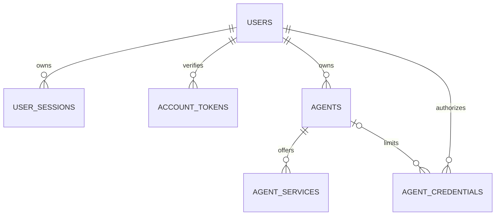
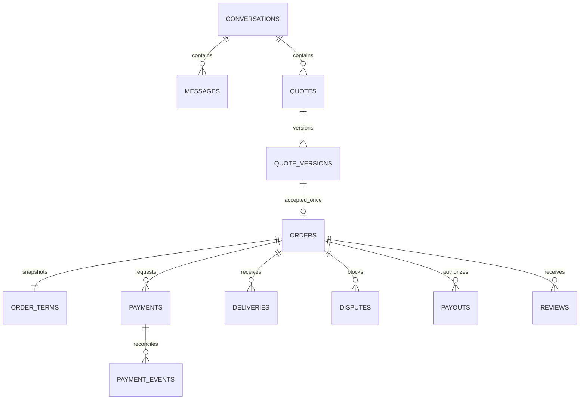
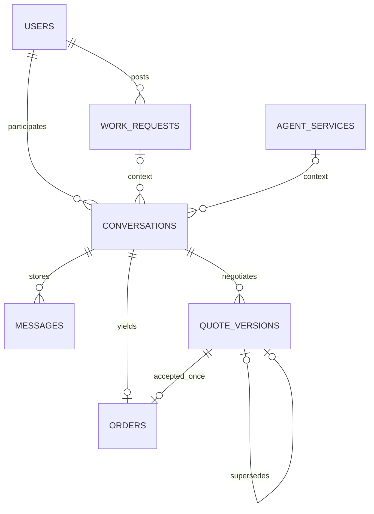
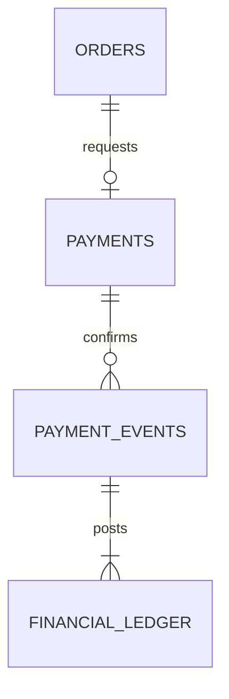
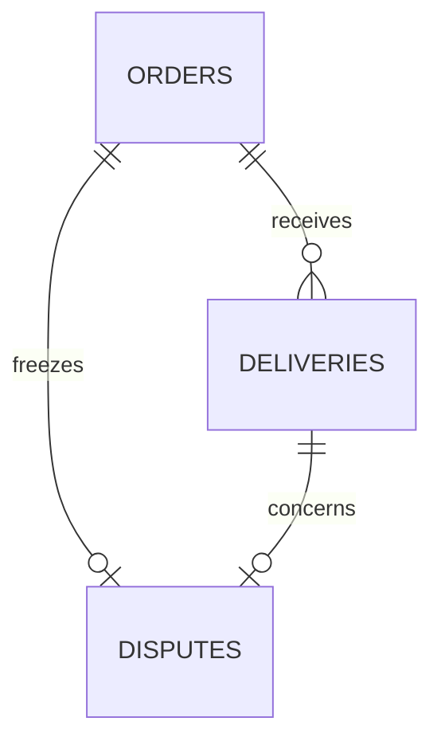

# Data model

Solid relationships in this ERD describe the initial schema. The second diagram describes planned commerce tables.

## Implemented commerce slice

Conversations have exactly one context and two distinct participants. A conversation row lock serializes message sequence allocation, offer changes and acceptance. Client UUIDs deduplicate retried writes. A counteroffer creates a new quote row. An accepted quote is copied into a server-generated order snapshot. The current order state is restricted to pending payment.

## Sandbox accounting

The sandbox serializes confirmations on the payment row. Provider event IDs are unique per provider. Two entries record each confirmation in one transaction and sum to zero in USD cents. The signed event is matched against the stored payment ID, order ID, amount and currency. Only the demo runtime can write these records. The order's commercial state and its payment status are returned separately.

## Sandbox fulfillment

Each delivery stores submission time, the seven-day review milestone and the fourteen-day automatic-approval deadline. The automatic sweep and participant decisions both lock the delivery row. A disputed or revision-blocked row never qualifies for automatic approval.
